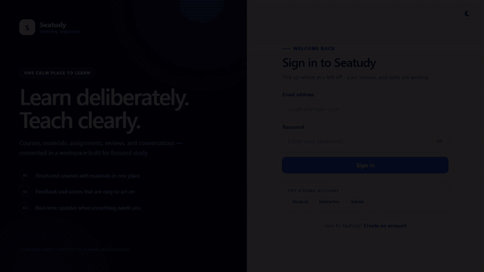

# Seatudy

Seatudy adalah platform kursus online dengan tiga peran: **student**, **instructor**, dan **admin**.

- **Frontend:** React 19 + Vite
- **Backend:** Node.js + Express 5
- **Database:** PostgreSQL
- **Auth:** short-lived JWT + rotating httpOnly refresh cookie
- **Real-time:** Socket.IO

## Preview

Tampilan dark mode dari alur utama Seatudy.



[▶ Tonton preview kualitas penuh (MP4, 22 detik)](docs/preview.mp4)

---

## Struktur Project

```
seatudy/
├── docs/                 # Preview GIF/MP4 untuk README
├── react-app/            # Frontend (React + Vite)
│   ├── e2e/              # Playwright end-to-end tests
│   ├── src/
│   │   ├── components/   # Auth, Courses, Dashboard, Assignment, Review, Forum
│   │   ├── contexts/     # Auth, Theme, Toast, Confirm
│   │   ├── lib/          # API client
│   │   ├── styles/       # theme.css (design token + komponen dasar)
│   │   └── App.jsx       # Routing
│   └── playwright.config.js
└── server/               # Backend (Express + PostgreSQL)
    ├── controllers/      # Route handlers
    ├── middlewares/      # Auth + upload (multer)
    ├── routes/           # API routes
    ├── db/
    │   ├── init.sql      # Schema database
    │   ├── migrations/   # Migrasi bertahap
    │   ├── demo-assets/  # File materi untuk data demo
    │   └── seed.sql      # Data demo (opsional)
    ├── scripts/          # migrate.js + seed.js
    ├── tests/            # Integration tests
    ├── utils/            # Token + cookie helpers
    ├── uploads/          # File upload (dibuat otomatis)
    ├── db.js             # Koneksi PostgreSQL
    ├── index.js          # Entry point
    └── .env.example
```

---

## Quick Start (Windows)

Prasyarat: Node.js 20+ dan PostgreSQL 14+. Jika PostgreSQL belum terpasang, project ini bisa memakai PostgreSQL portable di `..\pgsql`.

Jika PostgreSQL portable sudah disiapkan di `..\pgsql`:

```bat
start-dev.cmd   :: start database + backend + frontend, lalu buka browser
stop-dev.cmd    :: hentikan backend, frontend, dan database
start-db.cmd    :: start database saja
stop-db.cmd     :: stop database saja
```

Database lokal: `seatudy` di `127.0.0.1:5432` (user `postgres`, password `postgres`).

---

## Menjalankan Secara Lokal

### 1. Clone

```bash
git clone https://github.com/IniEyyy/seatudy.git
cd seatudy
```

### 2. Backend

```bash
cd server
npm install
cp .env.example .env
```

Sesuaikan `.env` dengan konfigurasi PostgreSQL lokal:

```env
PORT=5000
FRONTEND_URL=http://localhost:5173

DB_USER=postgres
DB_PASSWORD=your_db_password
DB_HOST=localhost
DB_PORT=5432
DB_NAME=seatudy

JWT_SECRET=ganti_dengan_string_random_panjang
```

Buat database, lalu jalankan migrasi:

```bash
createdb seatudy
npm run db:migrate
```

Opsional, isi data demo:

```bash
npm run db:seed
```

Jalankan server:

```bash
npm start        # production
npm run dev      # auto-restart (node --watch)
```

### 3. Frontend

```bash
cd react-app
npm install
cp .env.example .env
npm run dev
```

Frontend berjalan di `http://localhost:5173` dan memanggil API di `http://localhost:5000`
(nilai `VITE_API_URL` di `.env`; kosongkan untuk memakai origin yang sama di balik reverse proxy).

---

## Akun Demo

Tersedia setelah menjalankan `db/seed.sql`:

| Role       | Email                     | Password       |
| ---------- | ------------------------- | -------------- |
| Admin      | admin@seatudy.local       | Admin@123      |
| Instructor | instructor@seatudy.local  | Instructor@123 |
| Student    | student@seatudy.local     | Student@123    |

Seed juga membuat akun tambahan untuk mengisi data demo:

- Instructor: `rina@seatudy.local`, `bagas@seatudy.local`, `maya@seatudy.local` — password `Instructor@123`.
- Student: `alya@seatudy.local`, `bima@seatudy.local`, `citra@seatudy.local`, `dimas@seatudy.local`, `eka@seatudy.local`, `fajar@seatudy.local`, `gita@seatudy.local`, `hendra@seatudy.local`, `intan@seatudy.local`, `joko@seatudy.local`, `kirana@seatudy.local`, `lukman@seatudy.local` — password `Student@123`.

Total data demo: 18 akun, 9 course, 18 materi, 18 assignment, 26 enrollment, 25 pembelian, 25 submission, 22 review, 16 pesan forum, dan 18 notifikasi. Seed bersifat idempotent, jadi aman dijalankan ulang. File materi demo disalin dari `db/demo-assets/` ke `uploads/` saat seed dijalankan, sehingga preview file tetap bekerja pada clone baru.

---

## Environment Variables

| Variable       | Default                 | Keterangan              |
| -------------- | ----------------------- | ----------------------- |
| `PORT`         | `5000`                  | Port backend            |
| `FRONTEND_URL` | `http://localhost:5173` | Origin yang diizinkan CORS |
| `DB_USER`      | -                       | User PostgreSQL         |
| `DB_PASSWORD`  | -                       | Password PostgreSQL     |
| `DB_HOST`      | `localhost`             | Host PostgreSQL         |
| `DB_PORT`      | `5432`                  | Port PostgreSQL         |
| `DB_NAME`      | `seatudy`               | Nama database           |
| `JWT_SECRET`   | -                       | Secret untuk menandatangani JWT |
| `JWT_EXPIRES_IN` | `15m`                 | Umur access token              |
| `REFRESH_TOKEN_DAYS` | `7`               | Umur refresh token (hari)      |
| `NODE_ENV`     | `development`           | Set `production` untuk cookie `secure` |
| `VITE_API_URL` | `http://localhost:5000` (dev) | Base URL API frontend; kosong = same-origin |

---

## Fitur

- [x] Registrasi & login JWT
- [x] Role-based access (student, instructor, admin)
- [x] CRUD course oleh instructor
- [x] Upload materi (file) + preview/download
- [x] Top up saldo & pembelian course
- [x] Enrollment (course berbayar wajib dibeli dulu)
- [x] Assignment, submission (teks + file), penilaian
- [x] Halaman "My Assignments" untuk student
- [x] Ringkasan submission semua assignment untuk instructor
- [x] Review & rating course
- [x] Forum diskusi per course
- [x] Notifikasi real-time (Socket.IO)
- [x] Admin dashboard (kelola user + course manager: create/edit/reassign/delete course)
- [x] Dashboard berbeda per role dengan statistik dan aktivitas terbaru
- [x] Pencarian, filter, dan sorting pada katalog course
- [x] Toast notification konsisten (pengganti `alert`)
- [x] Default tema mengikuti sistem; tombol di navbar & halaman auth men-toggle Light/Dark (pilihan tersimpan di localStorage)
- [x] Health check database di `GET /api/health`
- [x] Proteksi dasar: Helmet, rate limit login/register, access token 15 menit + refresh token httpOnly yang dirotasi
- [x] File materi & submission diakses lewat endpoint terproteksi (cek enrollment/ownership), bukan URL publik
- [x] Validasi tipe file, batas ukuran upload, dan nama file acak
- [x] Migrasi database + trigger agregat (student count, rating) + index + constraint submission unik
- [x] Resubmission assignment, feedback instructor, dan bulk grading
- [x] Progress course, continue-learning, dan halaman sertifikat (semua assignment submitted + graded, rata-rata >= 60)
- [x] Forum dengan reply, edit, hapus, dan pagination
- [x] Admin pagination/search/sort + audit log perubahan role dan course
- [x] Dialog konfirmasi aksesibel (focus trap, Escape, aria-modal) + toast live region
- [x] Integration tests (`npm test` di `server`) dan E2E Playwright (`npm run test:e2e` di `react-app`)
- [x] GitHub Actions CI: migrasi, seed, integration tests, lint, build, dan E2E
- [x] Docker Compose untuk database, API, dan frontend nginx

---

## Testing

Backend integration tests membutuhkan database yang sudah dimigrasi dan di-seed, serta API yang berjalan di `http://localhost:5000`:

```bash
cd server
npm test
```

Frontend:

```bash
cd react-app
npm run lint
npm run build
```

### End-to-end (Playwright)

E2E memakai database yang sudah dimigrasi dan di-seed, karena test masuk dengan akun demo. API (`http://localhost:5000`) dan Vite dev server (`http://localhost:5173`) otomatis dipakai ulang jika sudah berjalan; kalau belum, Playwright menjalankannya sendiri.

```bash
cd react-app
npx playwright install chromium   # sekali saja
npm run test:e2e                  # jalankan semua test
npm run test:e2e:ui               # mode interaktif
npm run test:e2e:report           # buka HTML report terakhir
```

Cakupan: login valid/invalid dan redirect, dashboard serta course student, grading + chart instructor, pencarian user admin, course manager admin (filter + create/edit/delete), proteksi role, tema System/Light/Dark, dan layout mobile tanpa horizontal overflow. Screenshot, video, dan trace kegagalan tersimpan di `test-results/`, sedangkan report HTML ada di `playwright-report/`. Keduanya diabaikan git.

CI menjalankan migrasi, seed, integration tests, lint, build, lalu E2E lewat `.github/workflows/ci.yml`. Report Playwright diunggah sebagai artifact jika job gagal.

---

## Docker Compose (lokal)

Prasyarat: Docker Desktop dengan backend WSL2. Setelah WSL dan Virtual Machine Platform diaktifkan, restart Windows sekali agar Docker daemon bisa berjalan.

```bat
copy .env.docker.example .env
:: edit JWT_SECRET, dan ubah WEB_PORT jika 8080 sudah dipakai proses lain
docker compose up --build -d
docker compose exec server npm run db:seed
```

Buka `http://localhost:8080` (atau sesuai `WEB_PORT` di `.env`). Seed di atas opsional dan mengisi akun demo. Nginx meneruskan `/api` dan `/socket.io` ke container API; database dan upload memakai volume agar data tetap ada. Migrasi dijalankan otomatis saat container API start.

```bash
docker compose ps
docker compose logs -f server
docker compose down
docker compose down -v   # hapus volume database dan upload
```

Catatan:

- `JWT_SECRET` wajib diisi; Compose menolak start tanpa nilai tersebut.
- `COOKIE_SECURE=false` untuk akses HTTP lokal. Set `true` jika aplikasi disajikan lewat HTTPS.
- Port PostgreSQL tidak dibuka ke host. Gunakan `docker compose exec db psql -U postgres -d seatudy`.
- File `.env` berisi secret dan tidak di-commit.

---

## Troubleshooting

**Port 5000/5173 sudah dipakai**

```bat
stop-dev.cmd
start-dev.cmd
```

Atau hentikan proses yang menempati port tersebut lewat Task Manager.

**PostgreSQL gagal start**

Cek log di `..\pgsql\pg.log`. Pastikan port `5432` tidak dipakai PostgreSQL lain, lalu jalankan `start-db.cmd` lagi.

**Lupa/reset database lokal**

```bash
psql -U postgres -c "DROP DATABASE IF EXISTS seatudy;"
psql -U postgres -c "CREATE DATABASE seatudy;"
cd server
npm run db:migrate
npm run db:seed
```

**Login berhasil tetapi halaman kosong/403**

Pastikan role akun sesuai halaman yang dibuka. Student hanya bisa membuka halaman student, instructor halaman instructor, sedangkan admin dapat membuka dashboard admin, course manager, dan halaman user.

---

## Batasan

- Upload file disimpan lokal di `server/uploads/`, belum memakai object storage.
- Access token masih disimpan di `localStorage` (umur pendek); refresh token memakai cookie httpOnly. Untuk produksi, pertimbangkan menyimpan access token di memori dan menambahkan CSP.
- Belum ada verifikasi email, reset password, payment gateway nyata, atau course modules/sections.
- Rate limit masih in-memory; gunakan Redis jika API dijalankan lebih dari satu instance.
- File upload divalidasi dari ekstensi, belum deep content scanning.

---

## Catatan Pengembangan

- File upload disimpan di `server/uploads/` dan tidak masuk git.
- Folder upload dibuat otomatis saat server dijalankan.
- Schema bersifat idempotent (`CREATE TABLE IF NOT EXISTS`), aman dijalankan ulang.
- `server/node_modules` sengaja tidak lagi dilacak git; jalankan `npm install`.
- Styling memakai token di `src/styles/theme.css` (warna, radius, shadow, font Sora/Manrope). Komponen baru memakai class ber-prefix (`catalog-`, `teach-`, `sc-`, `sa-`, `ic-`, `isub-`) agar tidak bentrok dengan CSS lama.
- Design token utama: brand `#2563eb`, brand-deep `#0b1b3f`, accent amber, background `#f5f7fb`.
- Dark mode memakai atribut `data-theme="dark"` di `<html>`. Token warna di-override di `:root[data-theme='dark']` pada `src/styles/theme.css`; komponen sebaiknya memakai token (`--surface`, `--ink`, `--line`, `--danger-surface`, dst.) agar otomatis ikut tema.
